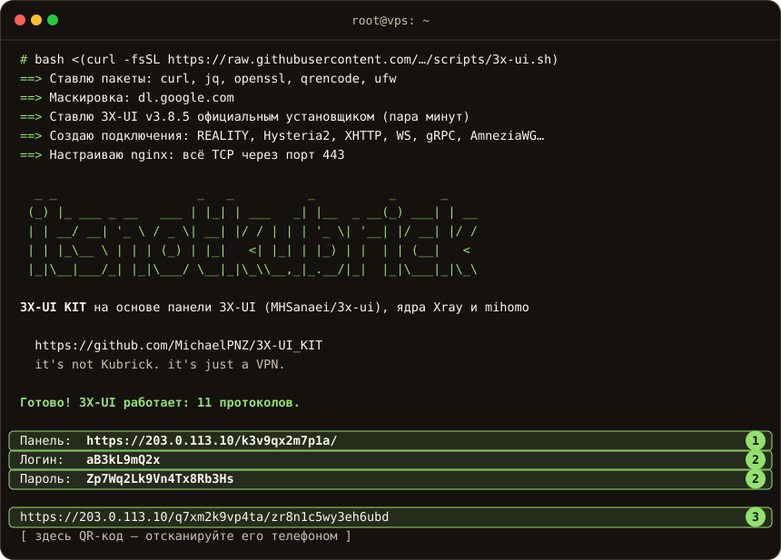

# 🛡 3X-UI KIT: все протоколы одной командой

[← На главную](../README.md)

Одна команда ставит панель [3X-UI](https://github.com/MHSanaei/3x-ui), создаёт подключения
на 11 протоколах и выдаёт **одну ссылку-подписку**: приложение само получит
подходящий ему формат и нужные протоколы. Домены не нужны.

**Что делает [скрипт](../scripts/3x-ui.sh):**

- ставит официальную 3X-UI проверенной версии её собственным установщиком
  и закреплённый Xray; в KIT 1.3.0 это панель v3.11.0 и ядро v26.10.21;
- выпускает сертификат Let's Encrypt на IP сервера и сам его продлевает;
- прячет панель на случайном порту и пути, со случайными логином и паролем;
- подбирает сайт для маскировки REALITY (с TLS 1.3 и HTTP/2) или, если хотите, использует ваш
  домен (`--domain`);
- создаёт подключения на всех протоколах из таблицы ниже, генерирует ключи
  и обфускацию AmneziaWG;
- включает единую подписку с учётом приложения: Clash Verge и FlClash получают готовый
  конфиг Mihomo с AmneziaWG, остальные приложения – ссылки только на то, что они умеют;
- открывает в ufw только нужные порты.

## Протоколы

| Протокол | Порт | Работает в |
|---|---|---|
| VLESS REALITY | 443/tcp | клиентах с ML-KEM и совместимым fingerprint, см. ниже |
| Hysteria2 | 443/udp | всех приложениях |
| VLESS XHTTP + REALITY | 443/tcp | v2rayN, Happ, Clash Verge, FlClash |
| VLESS WebSocket + TLS | 443/tcp | всех приложениях |
| Trojan gRPC + TLS | 443/tcp | всех приложениях |
| VMess WebSocket + TLS | 443/tcp | всех приложениях |
| Shadowsocks 2022 | 8388/tcp+udp | всех приложениях (если не подключается, попробуйте другой протокол) |
| TUIC v5 | 8444/udp | Hiddify, Clash Verge, FlClash, NekoBox |
| AmneziaWG | 51821/udp | AmneziaVPN, AmneziaWG, Clash Verge, FlClash |
| AmneziaWG 3.1 | 51822/udp | AmneziaVPN, AmneziaWG, Clash Verge, FlClash |
| MTProto | 443/tcp | прокси прямо в Telegram (если сервер сам достаёт до Telegram) |

**Все TCP-протоколы, панель и подписка работают через один порт 443.** Его слушает nginx:
по имени сайта в запросе (SNI) он узнаёт REALITY, XHTTP и MTProto, остальное расшифровывает
и разводит по секретным путям, а на всё прочее показывает сайт-заглушку. Заглушка своя у каждого сервера:
при установке она собирается случайно (тема, название, тексты, вёрстка, цвета) и лежит в `/var/www/kit/index.html`,
её же показывает Hysteria2. Можно положить туда свою страницу. Снаружи у сервера
открыты только 443, 80 (для продления сертификата), SSH, порт Shadowsocks 8388 и UDP-порты. Настоящие IP клиентов
доходят до панели, поэтому лимит устройств работает.

## Что понадобится

- VPS с Ubuntu 22.04/24.04 или Debian 12/13, доступ root по SSH
- Свободные порты **443** и **80** – на свежем сервере они свободны

## Установка

Подключитесь к серверу по SSH и выполните:

```bash
bash <(curl -fsSL https://raw.githubusercontent.com/MichaelPNZ/3X-UI_KIT/v1.3.0/scripts/3x-ui.sh)
```

Команда относится к подписанному релизу форка `v1.3.0`. Пока он не опубликован,
не используйте ветку подготовки как готовый релиз. Происхождение и лицензия: [NOTICE](../NOTICE.md).

Если запускаете в терминале, скрипт спросит, под какой сайт маскировать сервер:

- **1. Свой домен.** Ваш домен на этот сервер: самый надёжный вариант. Нужны A-запись домена на IP сервера и свободный порт 80, сертификат Let's Encrypt для домена скрипт получит сам.
- **2. Сосед по подсети** (Enter). Скрипт сам подберёт подходящий сайт среди соседних адресов вашей подсети. Домен не нужен.
- **3. Другой сайт.** Вы сами вводите адрес любого сайта (он должен отвечать по TLS 1.3 и HTTP/2). Подходит хуже соседа, потому что сайт живёт на другом IP.

Через пару минут скрипт покажет всё нужное:



1. **Адрес панели** – откройте его в браузере.
2. **Логин и пароль** от панели.
3. **Подписка** – вставьте её в приложение или отсканируйте QR-код.

Всё это, вместе с отдельными ссылками на каждый протокол, сохраняется в `/root/3x-ui.txt`:
посмотреть снова – `cat /root/3x-ui.txt`.

## Подключение

В приложении нажмите **+** → **Импорт из буфера** (или «Добавить подписку») и вставьте ссылку:

| Устройство | Приложение |
|---|---|
| iPhone, iPad | Happ, Streisand, Hiddify |
| Android | Hiddify, Happ, v2rayNG, FlClash |
| Windows, macOS, Linux | Hiddify, v2rayN, Clash Verge |

Подписка смотрит, какое приложение её запрашивает: Clash Verge и FlClash получают AmneziaWG,
а Happ, v2rayN, Karing и Hiddify – нет, потому что не умеют его. Для AmneziaVPN импортируйте
ссылки `vpn://` из `/root/3x-ui.txt`, для Telegram – ссылку `tg://` оттуда же.

### Совместимость REALITY

Xray v26.10.21 требует `X25519MLKEM768` в ClientHello. KIT приводит REALITY-профили к
`fingerprint=chrome`; Mihomo YAML также получает `reality-opts.support-x25519mlkem768: true`.
Одного обновления интерфейса приложения недостаточно: проверьте версию встроенного ядра,
обновите подписку и проверьте настоящее подключение.

По исходникам подтверждены Mihomo 1.19.32/1.19.33 с этими настройками и Xray 26.9.9 с `chrome`.
Для Happ 4.8.0 это относится к сборке со встроенным Xray 26.9.9. Точную минимальную версию GUI
Clash Verge, Happ или v2rayN из этих данных установить нельзя. Старые sing-box и другие
клиенты без нужной ML-KEM share могут перестать подключаться по REALITY; совместимость
Hysteria2 и других протоколов оценивается отдельно. Источники, версии и границы проверки:
[панель и ядро 1.3.0](panel-v3.11.0.md#клиенты-и-reality).

MTProto в режиме «всё на 443»: верный порт в ссылке – 443 (так же и в панели), 10445 – внутренний порт сервера,
снаружи он закрыт. Сайт маскировки зашит прямо в ссылку `tg://`, поэтому после `kit net site` прежние ссылки
перестают работать: kit выпустит пользователям ключи под новый сайт, а свежие ссылки даст `kit user link имя --telegram`.
`kit check` следит за mtg и ссылкой, `kit check --deep` ещё и стучится в mtg так, как это делает Telegram.

## Меню `kit`

Команда `kit` без аргументов открывает меню, как у `x-ui`: выберите цифру, остальное `kit` спросит сам. Запоминать команды не нужно, подсказки в самом KIT тоже ведут сюда: «kit → Пользователи → Показать ссылки» значит «введите `kit`, выберите 1, затем 3».

| Пункт | Что внутри |
|---|---|
| 1. Пользователи | список, добавить, показать ссылки (подписка, протоколы, AmneziaVPN, Telegram), лимит, выключить или включить, удалить |
| 2. Протоколы, порты и маскировка | протоколы и порты, сайт маскировки, порт протокола, включить или выключить протокол, отпечаток клиента, второй REALITY, панель по IP или домену, раздельная маршрутизация, DNS в подписках, ответ Hysteria2 чужим запросам, прежние имена сайта, поток vision |
| 3. Проверка сервера | быстрая, глубокая (подключиться клиентом), исправить безопасное |
| 4–6 | обновить kit и подписку, обновить панель 3X-UI, автообновление |
| 7. Резервная копия | копия сервера |
| 8. Версии | версии kit, панели и ядра |
| 9. Панель 3X-UI | меню `x-ui` |
| 10. Удалить KIT с сервера | полное удаление, спросит подтверждение |

Те же действия есть и командами (`kit user …`, `kit links`, `kit net …`, `kit check`, `kit update`, `kit panel update`, `kit core update`, `kit backup`, `kit uninstall`, `kit version`), справка: `kit help`.

> [!IMPORTANT]
> Используйте отдельные команды KIT для панели и ядра: они ставят закреплённые версии,
> проверяют SHA256 и предусматривают откат. Обновление из меню `x-ui` может выбрать другую
> версию и не учитывает ограничения клиентов KIT. Автообновление KIT не меняет ядро само.

## Дополнительные пользователи

Одна команда на сервере добавляет пользователя сразу во все протоколы и выдаёт его подписку с QR-кодом:

```bash
kit user add sasha --gb 50 --days 30
```

| Команда | Что делает |
|---|---|
| `kit user add имя [--gb N] [--days N] [--devices N]` | добавить; лимит трафика, срок и число устройств – по желанию |
| `kit user list` | кто сколько израсходовал, до какого числа и когда был в сети |
| `kit links [имя]` | все ссылки на подключения: подписка, отдельные протоколы, AmneziaWG, Telegram (без имени – первый пользователь) |
| `kit user link имя [--all \| --amnezia \| --telegram]` (рядом с подпиской – ссылки «открыть в приложении») | подписка и ссылки ещё раз: основные и запасные по группам; AmneziaVPN и Telegram – отдельными ключами |
| `kit user limit имя --gb N --days N` | изменить лимиты (0 – без ограничений) |
| `kit user off имя` / `kit user on имя` | временно выключить и включить |
| `kit user del имя` | удалить |

Трафик и лимиты общие на все протоколы: 50 ГБ – это 50 ГБ суммарно, через что бы пользователь ни подключался.

## Обновление

Обновления KIT и подписки kit-sub приходят сами: раз в сутки ночью сервер проверяет, не вышла ли
новая версия 3X-UI KIT, и ставит её. Пользователи, ссылки и подписки не меняются, раздавать
ничего заново не нужно.

Сервер ставит только **подписанные** релизы. Автор подписывает каждый релиз своим ключом, а
открытая часть ключа записана в `kit` на вашем сервере. Если файлы на GitHub подменят, подпись
не сойдётся и сервер откажется обновляться: одного взлома GitHub для этого мало. После
обновления сервер проверяет, что подписка отвечает, и при сбое возвращает прежнюю версию.
Панель 3X-UI и ядро Xray автообновление не трогает.

```bash
kit update            # обновить сейчас, не дожидаясь ночи
kit update --manual   # выключить автообновление
kit update --auto     # включить обратно
kit version           # версии kit, панели и ядра, включено ли автообновление
```

Журнал ночных обновлений: `/var/log/kit-update.log`.

Если `kit update` пишет, что подписка не отвечала ещё до обновления, выполните `kit check`, затем `kit fix`: обновление при этом не откатывается.

Установки оригинального KIT 1.2.x подписаны другим ключом и не переходят на форк автоматически.
Сохраните `kit backup`, затем выполните [команду ручного перехода из README](../README.md#переход-с-оригинального-kit-12x).
Она устанавливает доверие к ключу форка; после этого подписанные обновления приходят из MichaelPNZ.

Панель и ядро обновляются явно, с коротким перерывом подключений:

```bash
kit backup
kit update            # KIT и kit-sub; панель и ядро прежние
kit panel update      # панель v3.11.0; текущий бинарник Xray сохраняется
kit check --deep
# Убедитесь, что приложения обновлены и поддерживают REALITY с ML-KEM.
kit core update       # закреплённый Xray v26.10.21, с копией и откатом при ошибке
kit check --deep
```

До смены ядра обновите подписки на всех устройствах. После смены проверьте их из реальной
клиентской сети: глубокая проверка с самого сервера этого не заменяет. Обновление панели
обрабатывает миграции БД; для её ручного отката нужны прежние файлы панели и snapshot БД,
а для ядра — прежний бинарник и рабочий конфиг. Пути копий выводятся командами обновления.
Подробности: [проверка перехода на v3.11.0](panel-v3.11.0.md).

## Проверка и починка

```bash
kit check            # проверить сервер, ничего не меняет
kit check --deep     # то же и подключиться клиентом (REALITY, XHTTP, Hysteria2) с самого сервера
kit check --fix      # исправить безопасное
```

`kit check` проверяет службы, что ядро Xray запущено и каждое включённое подключение слушает свой порт (TCP и UDP
отдельно), версии, срок сертификата, что панель не торчит наружу, права на файлы с
паролями и ключами, ответ подписки для Happ, Hiddify, v2rayN и Clash, наличие TUIC в raw-подписке
при включённом TUIC для проверяемого клиента, а также что сайт маскировки отвечает по
TLS 1.3 и HTTP/2, и подсказывает, что улучшить (сайт маскировки, лишние порты). Вывод можно просто прислать в чат, если нужна помощь.

`kit check --fix` лечит только безопасное: перезапускает упавшие службы и ядро Xray, возвращает права `600`, включает
автообновление, перечитывает сертификат и снимает TLS у встроенной подписки 3X-UI (его включает команда
`x-ui cert`, и подписка перестаёт отвечать). Ничего необратимого он не делает.

> [!NOTE]
> Проверка идёт с самого сервера: доступность из вашей сети она не покажет.

## Протоколы, порты и сайт маскировки (`kit net`)

```bash
kit net                     # протоколы, порты, статус, сайт маскировки и отпечаток одним экраном
kit net site                # подобрать сайт маскировки среди соседей по подсети (около минуты)
kit net site сайт.com       # или задать самому (проверю TLS 1.3 и HTTP/2)
kit net site cleanup        # сразу убрать прежние имена сайта, не дожидаясь 7 дней
kit net port имя порт       # сменить порт подключения: ufw и ссылки обновятся сами
kit net off vmess-ws        # выключить протокол и закрыть его порт (вернуть: kit net on vmess-ws)
kit net on reality2         # создать второй REALITY на высоком порту
kit net fp chrome           # совместимый отпечаток; REALITY в подписках KIT нормализуется к chrome
kit net masq on             # Hysteria2 отвечает на чужой запрос страницей сайта
kit net panel domain        # панель и подписка открываются и по домену (только со своим доменом); kit net panel ip – как раньше
kit net split on          # через VPN только список (по умолчанию популярные иностранные сервисы), остальное напрямую; kit net split check | off
```

Панель меняет подключения на ходу, без перезапуска. Если ядро Xray не приняло правку и порт закрылся (так бывает с
маскировкой Hysteria2), `kit net` сам перезапускает ядро и говорит об этом: подключения прерываются на пару секунд.

После `kit net site` прежнее имя сайта у REALITY и XHTTP ещё 7 дней работает рядом с новым: приложения со старой
подпиской не отваливаются, пока вы её не обновите (Happ, Karing, v2rayN, Hiddify, Nekobox – «Обновить подписку»).
Потом прежнее имя я убираю сам (`kit check` показывает срок); убрать сразу – `kit net site cleanup`. В новые ссылки и
в `kit backup` прежнее имя не попадает. MTProto льготного срока не имеет: ссылки `tg://` нужно разослать заново.
Имя, которое уже занято другим подключением (например, вашим доменом у REALITY), `kit net site` не возьмёт: каждому
подключению нужен свой сайт.

Со своим доменом панель и подписка по умолчанию открываются по IP (`https://IP/путь/`). Если нужен адрес с доменом (например, для Telegram-бота панели
или ссылки, которая не зависит от IP), выберите «по домену» при установке (`--panel-on domain`) или позже: `kit net panel domain`. Путь у них секретный и по домену, как и по IP.

### Раздельная маршрутизация (`kit net split`)

Если нужно, чтобы через VPN шли только выбранные сервисы, а всё остальное напрямую, включите: `kit net split on`. На сервере появится
файл `/etc/kit-sub/rules.yaml` со списком иностранных сервисов (по умолчанию популярные: нейросети, видео и музыка, соцсети и мессенджеры, GitHub, Google и другие, всего около 50 категорий; тяжёлые и региональные – в комментариях, раскомментируйте нужные). Российские сайты в список не добавляйте: всё, чего в нём нет, и так идёт напрямую.
Правила приезжают вместе с подпиской, на телефонах и компьютерах ничего настраивать не нужно: достаточно обновить подписку в приложении.

| Приложение | Как получает правила |
|---|---|
| Clash Verge, FlClash, Mihomo Party (ядро Mihomo) | из подписки, сразу (режим «Rule», не «Global») |
| Happ | заголовком подписки (профиль «3X-UI KIT» включается сам) |
| Приложения, которые берут JSON-подписку Xray (адрес «JSON» со страницы подписки) | из конфига подписки |
| v2rayN, v2rayNG и другие с обычным списком ссылок, Karing, Hiddify, sing-box | не получают: подписка прежняя, весь трафик через VPN; раздельную маршрутизацию там настраивают в самом приложении |

```
kit net split on       # создать список и включить
nano /etc/kit-sub/rules.yaml
kit net split check    # проверить файл: сколько правил применится и что отброшено
kit net split apply    # после правки списка: обновить профили Happ и Xray в панели (Mihomo берёт файл сам)
kit net split off      # выключить (список сохранится в rules.yaml.off)
```

Формат: `GEOSITE,youtube` (готовая категория), `DOMAIN-SUFFIX,example.org`, `DOMAIN,api.example.org`, `DOMAIN-KEYWORD,слово`, `IP-CIDR,203.0.113.0/24`.
Лишнее и непонятное KIT отбрасывает; если список пуст или повреждён, подписка отдаётся как обычно. Список входит в `kit backup`.
DNS при этом не течёт: имена из списка у клиента не разрешаются, а запросы про них идут по DoH через VPN; для остального сайта используется
системный DNS приложения (или адреса `direct_dns` из файла). Категории GEOSITE приложение один раз скачивает с GitHub.

Лучший сайт маскировки – ваш собственный домен (`--domain` при установке): сервер изображает ваш сайт, а сертификат
и имя совпадают. Без домена установщик подбирает сайт среди соседей по подсети сервера: около 250 коротких обращений к порту 443
соседних адресов (не нужно – укажите `--sni сайт` или `--domain`). Любой протокол можно выключить командой `kit net off имя` и включить обратно `kit net on имя`.

## Резервная копия

```bash
kit backup
```

Сохранит в `/root/kit-backup-ДАТА.tar.gz` копию сервера: подключения, ключи, пользователей с их
лимитами, настройки подписки и nginx. Файл виден только root, и в нём ключи от сервера, поэтому
храните его как пароль. Скачать к себе:

```bash
scp root@IP:/root/kit-backup-ДАТА.tar.gz .
```

Храните копию отдельно от сервера.

Новый чистый сервер поднимается из копии одной командой (нужны `3x-ui.sh` и файл копии):

```bash
bash 3x-ui.sh --restore /root/kit-backup-ДАТА.tar.gz -y
```

Подключения, ключи, пользователи и их лимиты вернутся прежними. Если адрес сервера сменился, подписку клиентам нужно
добавить заново, а на домене ничего менять не придётся: достаточно переключить DNS.

Сертификат Let's Encrypt на новый IP выпускается заново. Если он не выдался (лимит – 5 сертификатов в неделю на один IP,
или закрыт входящий порт 80), скрипт скажет об этом и поставит самоподписанный сертификат с отпечатком в ссылках:
ссылки на подключения работают, а подписка в приложениях может не открыться. Если ядро Xray после восстановления
не запустилось, скрипт не скажет «Готово», а покажет, где искать причину.

Восстанавливайте только из своей копии. Архив с чужими путями, ссылками, лишними настройками или значениями
не в своём формате (порт – не число, путь со странными символами, непечатные байты в файлах настроек) скрипт не примет («Это не резервная копия 3X-UI KIT…») и ничего не изменит.

## Параметры

| Параметр | Что делает |
|---|---|
| `--protocols reality,hy2,ws` | только выбранные протоколы; `minimal` – только REALITY |
| `--port 8443` | порт REALITY (TCP) и Hysteria2 (UDP) вместо 443 |
| `--cert fullchain.pem --key privkey.pem --host домен` | свой сертификат, например для домена |
| `--sni www.samsung.com` | чужой сайт для маскировки REALITY |
| `--domain vpn.example.com` | свой домен для маскировки (A-запись на IP сервера, свободный порт 80) |
| `--no-ufw` | не трогать файрвол |
| `--multi-port` | прежняя схема: у каждого протокола свой порт, без nginx |

## Как устроена подписка

Наружу смотрит небольшой сервис [kit-sub](../scripts/kit-sub.py) (Python, служба `kit-sub`),
а подписка 3X-UI работает только внутри сервера. kit-sub узнаёт приложение по User-Agent,
добавляет AmneziaWG в конфиг для Clash-приложений, убирает из заголовка «срок 0», из-за которого
приложения показывали 01.01.1970, и сам подхватывает продлённый сертификат.
В 1.3.0 он также нормализует REALITY для нового ядра и восстанавливает потерянные панелью
v3.11.0 ссылки TUIC из данных HTML-страницы той же подписки. Управленческий API-токен для
этого не используется; уже присутствующие ссылки не дублируются.

> [!NOTE]
> Если порт 80 занят или Let's Encrypt не выдал сертификат на IP (порт закрыт у хостера, исчерпан
> лимит выпусков, сбой), скрипт скажет об этом и сделает свой сертификат, а панель будет
> доступна через SSH-туннель (команду для туннеля он покажет). Подписка в этом режиме
> работает только изнутри сервера – используйте отдельные ссылки.
> Свой домен (`--domain`) без сертификата на IP не работает: скрипт остановится с пояснением.

## Обслуживание

Управление панелью – официальная команда `x-ui`: перезапуск, логи, обновление, удаление.

```bash
x-ui
```

---

[← На главную](../README.md)
